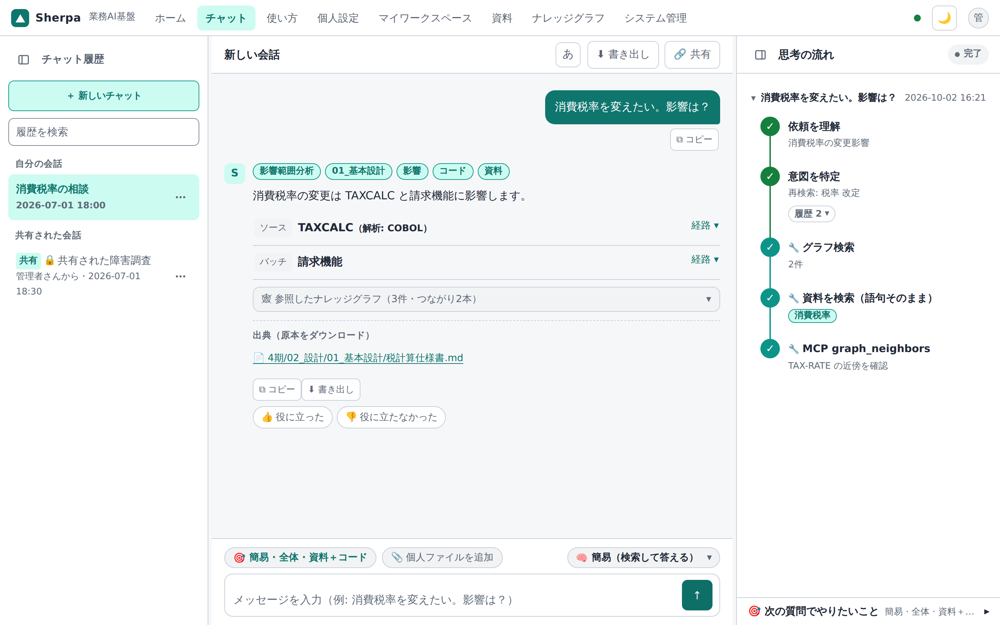
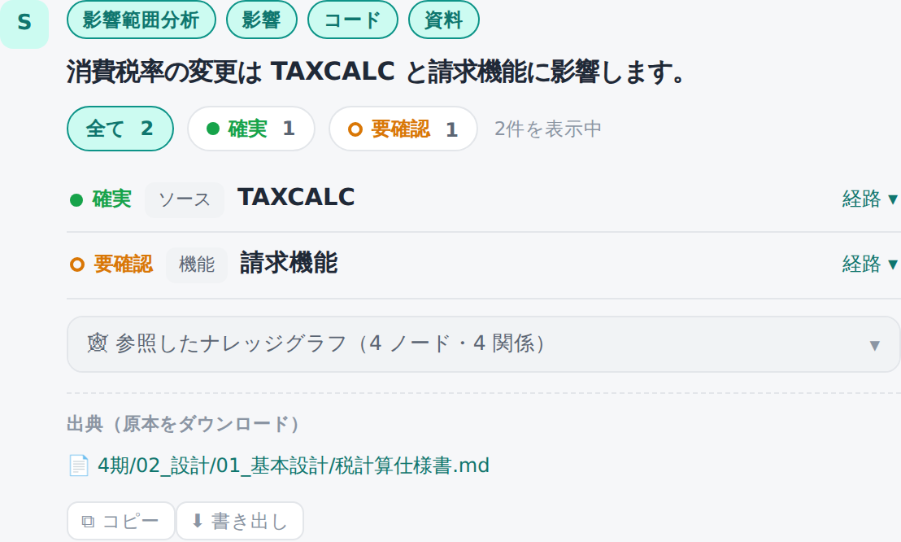
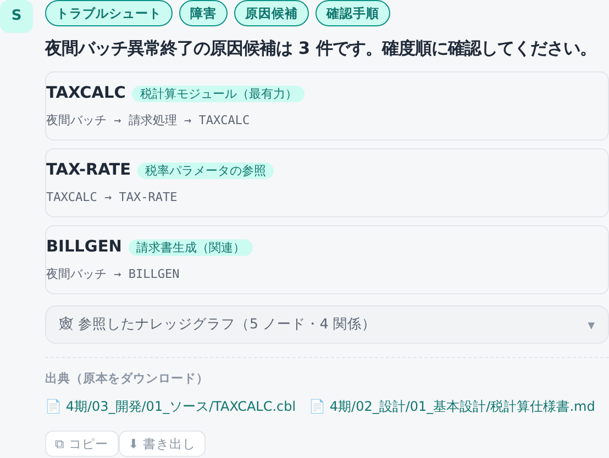
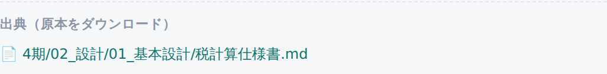
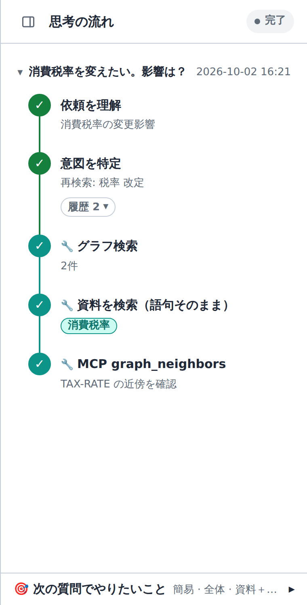
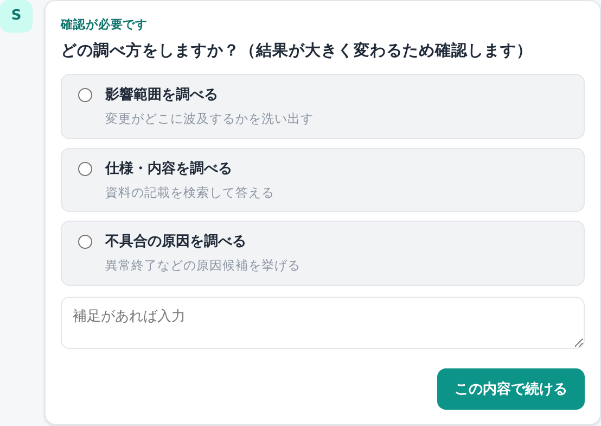

# 10. 使い方：チャットで調べる

入口は**チャット**です。依頼内容を日本語で書き、「調べる」か「作る」を選んで送ると、**根拠つき**で答えます。

認証が有効な環境では、先にログインします。ログイン後の会話履歴・共有・個人ファイルは自分のユーザーに紐付きます。

画面は3ペイン構成です。

- **左**: 「チャット履歴」。「＋ 新しいチャット」で会話を始めます。「履歴を検索」では、題名だけでなく会話の本文からも探せます。各会話の「…」メニューから、名前の変更・ピン止め・履歴の削除ができます。自分の会話と、共有された会話は分かれて表示されます。共有された会話は読み取り専用です。
- **中央**: 会話本体。答えは**本文が先頭**で、その下に**参照した資料**（原本をダウンロード）が並びます。上部には「書き出し」「共有」ボタンと、文字の大きさを変える「あ」ボタンがあります。入力欄の上には、今の設定を短く示す「🎯」の表示、「📎 個人ファイルを追加」、使う AI を選ぶ「🧠」があります。
- **右**: 上が「思考の流れ」。AI が資料をどう検索し、読み、たどったかが流れます。下が「次の質問でやりたいこと」で、調べ方・範囲・参照するものを選びます（[11. 範囲とAIの切り替え](11-使い方-範囲とAI.md)）。

## 質問を送る

1. 右ペイン下部の「やりたいこと」で、**調べる**（標準）か**作る**を選びます。資料の作成を頼みたいときだけ「作る」にします。
2. 入力欄に依頼を書き、`Enter` で送信します（`Shift`+`Enter` で改行）。
3. 回答中は送信ボタンが「■」に変わり、押すと途中で止められます。

回答の途中で別の画面へ移っても、回答は続きます。画面上部に「⏳ 回答作成中」と出るので、押すと会話に戻れます。

入力の先頭に `/作成 ` と書くと、その1回だけ「作る」として送れます（`/影響 `・`/原因 `・`/内容 ` は、その1回だけ「調べる」です）。

## 影響範囲分析を依頼する

> 例：「**消費税率を変えると何に影響する？**」

「調べる」で送ると、AI が資料とソースを自分で調べ、**回答の本文**に、影響が及ぶ先とその理由をまとめます。

- AI がつながりをたどれたときは、本文の下に**影響一覧**の表（名前・状態・理由）が付きます。起点には「起点」の印が付きます。
- 状態は次の4つです。**候補**（つながりをたどれた）／**確かめた**（AI が資料を開いて確かめた）／**根拠に使った**（回答の根拠に出てくる）／**対応不明**（資料の場所が分からず、回答の根拠と結べない）。
- たどっていないときは「影響をたどっていません」、影響先が見つからないときは「グラフでたどれる影響先は見つかりませんでした」などと、その理由とともに表示します。表が出ない回答もあります。
- 気になる項目は、続けて「なぜ？」と質問すると、根拠（設計書の該当記述など）と**原本ダウンロード**付きで答えます。

## トラブルシュートを依頼する

> 例：「**夜間バッチが異常終了した。原因は？**」

「調べる」で送ると、AI が資料とソースを自分で調べ、**原因の候補**と**確認手順**を回答の本文にまとめます。根拠は回答の下の**参照した資料**（AI が実際に読んだ資料）で示します。

関連する部品のつながり（呼び出し・コピー・参照など）をたどって調べるため、障害の原因が別の部品にある場合も候補に挙がります。

## 仕様を問い合わせる

> 例：「**請求額はどう算出している？**」

「調べる」で送ると、AI が調べた内容を回答の本文にまとめ、根拠は回答の下の**参照した資料**で示します。**根拠が見つからなければ、見つからなかったことを正直に**書きます（推測で埋めません）。

## 手早く調べたいとき（簡易）

頭脳で「**簡易**」を選ぶと、資料を数回だけ検索して手早く答えます（[11. 範囲とAIの切り替え](11-使い方-範囲とAI.md)）。

- 出てくるのは検索して答えた文章と出典だけです。影響一覧や資料の作成は出ません（資料を作りたいときは「Codex 調査」で依頼します）。
- 確認できた出典が足りないときは、答えの前に「確認できた出典が不足しているため、内容は未確認です」と、調べる回数の上限に達して途中までのときは「調べる回数の上限に達したため、回答は途中までです」と書かれます。
- 答えの最後には、いつも「網羅性・確証が要る質問は「Codex 調査」へ」という案内が付きます。
- 簡易を選ぶと、右ペインの「やりたいこと」「見方」「調べる深さ」「詳細」の行は隠れ、「簡易は数回だけ検索して答えます。網羅・確証が要るときは Codex 調査へ」という案内が出ます（簡易では効かないためです）。

## 設計書とソースの照らし合わせ

頭脳が「**Codex 調査**」のとき、Codex が設計書とソースの**両方を確かめた項目**があれば、回答本文の下に「設計書とソースの照らし合わせ」の表が出ます。項目ごとに、設計書の記述・ソースの実装・判定が並びます。

- 判定は **一致**／**食い違い（ソースが正）**／**設計書に記述なし**／**ソースに見当たらない**／**未確認**。食い違いなど注意が要るものを先に、一致を後ろに並べます。
- 設計書とソースが食い違うときは、ソースを正として扱います。
- 根拠の資料名（📄）を押すと原本が開きます。根拠の資料を確認できなかった項目は「未確認」になります。
- 両方を確かめた項目が無い回答、「簡易」の回答には表は出ません。

## 出典＝原本ダウンロード

根拠がある回答には、本文の下に**参照した資料**（原本をダウンロード）が付きます（簡易と「作る」では見出しが「出典（原本をダウンロード）」です）。📄 の資料名を押すと、**MD 化した写しではなく原本**（Office なら元の Excel/Word/PowerPoint、ソースなら原文）がダウンロードされます。

資料名の横や下には、次のような補足が付くことがあります。

- 「（読み取り機能で開いた: 行12-30）」: AI が開いて読んだ行の範囲。
- 「（5期・2026-07-01 12:30 更新）」: 資料フォルダ直下のフォルダ名と、原本の更新日時。
- 「（読み取り機能で開いた記録なし）」: 回答には挙がっているが、AI が中身を開いた記録がない資料。内容は原本で確かめてください。
- 「（本文で名前が出た資料）」: 回答の本文に名前が出ただけの資料。開いた記録がないときは「（本文で名前が出た資料・読み取り機能で開いた記録なし）」と出ます。
- 「ほかに見つかった資料（読み取り機能で開いた記録なし）」: 検索には出たが、AI が開いていない資料（折りたたみ）。
- 「確認できなかった資料」: 回答に挙がったが、実在や範囲を確かめられなかった資料。理由が添えられます。秘匿の資料も名前は表示します（中身は出しません）。資料の名前として読み取れない行だけ「名前を表示できない資料 N 件」とまとめます。

資料を調べて答えた回答では、本文の下に、確認の状況を示す短い行（「注意」「調べた項目」「確認できなかった項目」など）が付くことがあります。「調べた項目」には「対象 N 件のうち、確かめた X 件・確かめられなかった Y 件・未着手 Z 件」と出ます。上限に達して途中までだったときも、ここに書かれます。

回答の本文に出た資料名のうち、参照した資料と一致するものは、押すと原本をダウンロードできます。

回答の「調査の記録」にある「📋 Markdown でダウンロード」からは、AI が何をどう調べたかの記録を取り出せます。

根拠が見つからなかったときは「参照した資料はありません」（簡易と「作る」では「確証のある資料は見つかりませんでした」）と表示します。個人ファイルが根拠になった場合は、別枠の「個人ファイル内ヒット（本人のみ・共有不可）」に出ます。

> 根拠のない断定はしません。参照した資料がないときは、そう明示します。

## 回答を書き出す・評価する

- 回答の下の「⧉ コピー」で回答欄の文字（本文のほか、参照した資料なども含みます）をコピー、「⬇ 書き出し」でその回答を Markdown として保存できます。
- 画面上部の「書き出し」では、会話全体を Markdown・テキスト・JSON・PDF（印刷で保存）にできます。
- 「👍 役に立った」「👎 役に立たなかった」で回答を評価できます。「役に立たなかった」を押すと、理由の候補と一言を添えて送れます。管理者が集計に使います。
- 「🕓 この回答の思考の流れ」を押すと、右ペインのその回答の分が開きます。

## 画像の中の文字も探せます

資料に貼り込まれた画面キャプチャや図の中の文字も、検索の対象です。Word や Excel に貼った画像でも、
画像ファイル単体でも探せます。出典は**その画像を貼った資料**（元の Word/Excel）になります。

ただし読み取りには誤りが混じります。特に英数字の識別子は取り違えが起きやすく、`Office` が
`0ffice` になるようなことがあります。**画像から読んだ文字は、そのまま鵜呑みにせず原本で確かめてください。**
出典から原本をダウンロードできます。

**縦書き**（スキャンした冊子など）は、小さい文字が落ちることがあります。実測では「使って」が「使て」、
「ケープタウン」が「ケプタウン」のように、促音・長音・読点が抜けました。うまく見つからないときは、
確実に読めている部分（漢字の語）で探し直すと当たります（例:「ケープタウン」より「菜園」）。

## 思考の流れを見る

右ペインに、AI が「まず資料を検索して当たりを付け → 関係箇所を読み → 外れたら検索語を変える → 必要なら部品のつながりをたどる」と調べる過程が流れます。何を根拠にした答えかが透けて見えます。過去の回答の分も、会話を開くと回答ごとに積み重なって見られます。

## 会話を共有する

自分の会話は、画面上部の**共有**ボタンから他ユーザーへ共有できます。

- 招待するユーザーを入力します。名前や表示名の一部を入れると候補が出るので、選んで確定します（ユーザー名をカンマ区切りで直接入力してもかまいません）。
- 有効期限を1日・3日・7日・14日・30日（標準）から選びます。共有には必ず期限があります。
- 発行された共有リンクは、その画面にだけ表示されます。必ずその場でコピーして相手に渡します。
- 招待されたユーザーがログインしてリンクを開くと、読み取り専用の会話として追加されます。

共有ダイアログの「この会話の共有」には、これまでの共有が一覧で出ます。期限を今から30日後に延ばす**延長**や、共有をやめる**取消**もここでできます。

個人ファイルを参照した会話は、そのままでは共有できません。共有ボタンが無効になります。

詳しくは [12. ログイン・共有・個人ファイル](12-使い方-ログイン共有個人ファイル.md)。

## 確認を求められたら

調べる範囲や狙いが曖昧で、確認しないと結果が大きく変わる場合や、依頼文に「確認してから進めて」と書いた場合は、**確認カード**（選択肢）が出ます。「この内容で続ける」を押すと、選んだ条件で調査が続きます。

## 困ったとき

**回答が資料に基づいていない**

- 簡易で聞いている場合は、網羅性が要る質問を「Codex 調査」に切り替えて聞き直します。
- 「社内資料」がオンになっているか、資料フォルダと範囲が正しいか確認します（範囲を絞りすぎていないか）。
- 資料がまだ取り込み中でないか、管理者に取り込み状況を確認してもらいます。

**参照した資料が出ない**

- 根拠が見つからなかった可能性があります。範囲を広げて再質問します。参照した資料がなく、範囲や調べる深さを絞っているときは、回答の下に「範囲を全体に広げる」「調べる深さを上げて探す」などのボタンが出ます。押すと同じ質問をやり直します。
- 質問に対象名（画面名・帳票名・ジョブ名など）を足すと見つかりやすくなります。

**「読み取り量の上限に達したため、ここまでの結果で答えています」などと出た**

- 資料フォルダを絞るか、「調べる深さ」を「深く」にして聞き直すと、さらに調べます。「時間の上限に達したため」と出たときは「続き」と送ると、続きから調べます。

---

次は、検索の**範囲**や使う **AI** を切り替える方法 → [11. 範囲とAIの切り替え](11-使い方-範囲とAI.md)。
