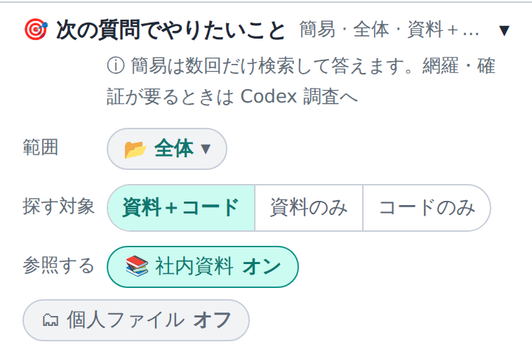
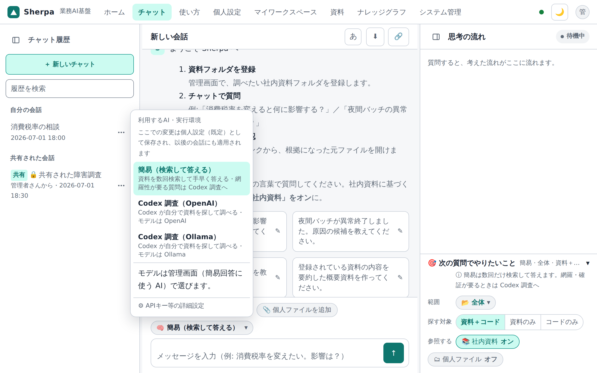
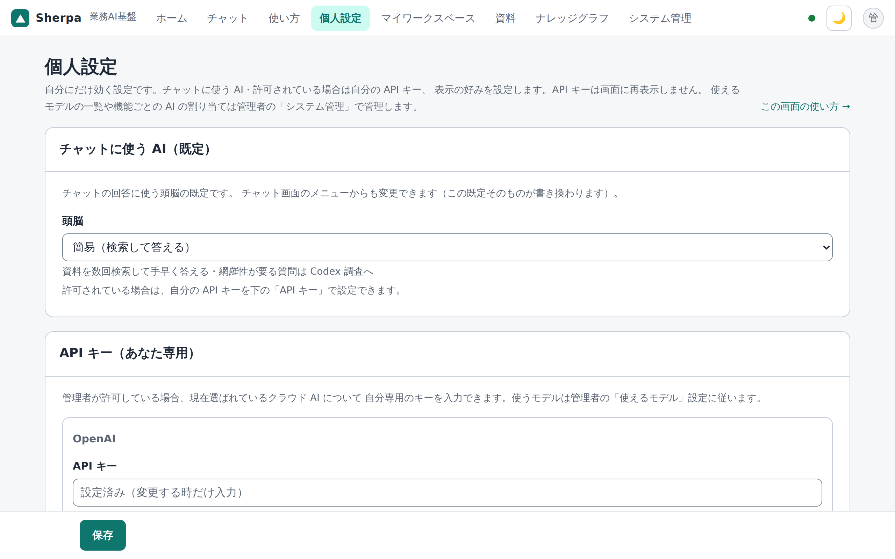

# 11. 使い方：範囲とAIの切り替え

チャットでは「**社内資料を参照するか**」「**どの範囲を見るか**」「**どの AI で考えるか**」を切り替えられます。範囲や参照の切り替えは、チャット画面の右側の下部にある「**次の質問でやりたいこと**」で行います。入力欄の上の「🎯」には、今の設定が短く表示されます（例: 「調べる · 全体 · 標準」）。押すとこの欄が開きます。

## 社内資料の参照

「参照する」の行に「**📚 社内資料**」のオン／オフがあります。**既定はオン**で、頭脳が「Codex 調査」でも「簡易」でも、社内資料を調べて出典つきで答えます。範囲の指定や「やりたいこと」「調べる深さ」もオンのときに使えます。

**オフ**にすると、社内資料も個人ファイルも調べず、一般的な知識だけで答えます（出典は付きません）。頭脳が「Codex 調査」でも、オフのときは「簡易」と同じ AI（管理者が「簡易回答に使う AI」で選んだもの）が答え、回答の先頭に「社内資料は参照していません（資料参照がオフのため、一般的な知識での回答です）。」と表示されます。前の会話の内容は引き続き踏まえます。回答の上には「💬 通常チャット（社内資料参照オフ）」と表示されます。

## 個人ファイル参照のオン／オフ

マイワークスペースにファイルを置いている場合は、「参照する」の行の「**🗂 個人ファイル**」をオンにできます（既定オフ）。

| 状態 | 動き |
|------|------|
| **オフ**（既定） | 社内資料だけを使う。個人ファイルは見ない。 |
| **オン** | 自分の個人ファイルもキーワードで探し、回答に「個人ファイル内ヒット」として追加する。 |

個人ファイルは本人のマイワークスペースだけが対象です。社内資料の検索の対象には入りません。社内資料が「オフ」のときは読みません。個人ファイルを参照した会話は通常共有できません。

## 調べ方の設定

右側の下部にある「次の質問でやりたいこと」には、次の項目があります。簡易のときは「範囲」「参照する」だけが残ります。

| 項目 | 内容 |
|------|------|
| **やりたいこと** | 「**調べる**」（標準）か「**作る**」。影響の調査・原因の調査・仕様の確認はどれも「調べる」です。資料（ファイル）を作ってほしいときだけ「作る」にします。 |
| **見方** | 「📄 資料を中心に見る」をオンにすると、設計書・資料を中心に調べます（ソースは設計書との食い違いの確認のために読みます）。「調べる」のときだけ使えます。 |
| **調べる深さ** | 「クイック」「標準」「深く」「最大」。見直しの回数と読む量の目安で、クイックは見直しなし、標準は1回、深くは3回（広く読む）、最大は6回（さらに広く読む）です。十分に調べられたら途中で終わります。使う AI によっては見直しが行われない構成があります。|
| **範囲** | 調べるフォルダを絞ります（次の節）。 |
| **参照する** | 「社内資料」「個人ファイル」のオン／オフ。管理者が許可していて、頭脳が「Codex 調査（OpenAI）」のときだけ「🌐 Web 検索」も出ます（既定は非表示）。 |
| **詳細**（既定は閉じています） | 「使う検索」（語句そのまま検索／意味・表記ゆれも探す／グラフ）。画面の説明のとおり、Codex 調査には効きません（Codex は自分でファイルを探すため）。 |

新しい会話は、「調べる」・資料を中心に見るはオフ・標準・Web 検索はオフで始まります。会話を開き直したときは、その会話で最後に使った設定に戻ります。

## 範囲（資料フォルダ・フォルダ）

社内資料参照オンのとき、**範囲**を選べます。

- **資料フォルダ**: 調べる対象の登録フォルダ。会話画面の上部にある「資料フォルダ」の選択欄で切り替えます。登録が1つだけなら選択欄は出ません。切り替えると範囲は「全体」に戻ります。
- **範囲**: その中の特定フォルダに絞り込みます（例: 「設計」だけ・「保守」だけ）。「範囲」の行の「📂 全体 ▾」を押すと、フォルダの一覧が開きます。「全体」を選ぶと絞り込みを外します。複数のフォルダを選べ、「フォルダ名で絞り込み」で名前から探せます。フォルダ木がそのまま範囲になります。選べるフォルダが1つしかないときは、範囲の行は出ません。

範囲を絞ると、検索・影響分析・出典が**その範囲内だけ**に限定されます（範囲外の資料は引用元に出ません）。選んだフォルダの中が対象です。共通で使う部品の置き場所も対象に含めたいときは、そのフォルダも合わせて選びます。

## 頭脳（AI）の切り替え

入力欄の上の「**🧠**」ボタンで、回答の作り方を選べます。ボタンには今の AI（例:「Codex」「簡易（検索して答える）」）とモデル名が表示され、押すと「利用するAI・実行環境」のメニューが開きます。選べるのは「Codex 調査」と「簡易」の2つです。ここでの変更は個人設定（既定）として保存され、以後の会話にも使われます（[13. 個人設定](13-個人設定.md)と同じ設定です）。

| 頭脳（画面の表示） | 特徴 |
|------|------|
| **Codex 調査（OpenAI）** | 標準。OpenAI Codex CLI が資料とソースを自分で探して調べ、調べる過程が見えます。網羅性・確証が要る質問や、資料（ファイル）の作成に向きます。 |
| **Codex 調査（Ollama）** | 同じ調べ方で、モデルだけ社内のローカル AI（Ollama）を使います。外部に出さない構成向けで、応答品質はモデル次第です。 |
| **簡易（検索して答える）** | 資料を数回だけ検索して手早く答えます。速く答えが欲しい質問向きで、網羅性が要る質問や資料の作成は Codex 調査で行います。 |

- **簡易を選んだとき**: 「やりたいこと」「見方」「調べる深さ」「詳細」の行は隠れ、「簡易は数回だけ検索して答えます。網羅・確証が要るときは Codex 調査へ」という案内が出ます。簡易が使う AI は管理者が決めます（個人設定には選択欄がありません。管理者の「簡易回答に使う AI」で、他のアプリから呼び出す簡易回答と共通です）。
- **以前の選択が残っているとき**: 以前に「OpenAI」「ローカル（Ollama）」の直結、「AI を使わない簡易」「Gemini」「AWS Bedrock」を選んでいた場合は、別の AI に勝手に切り替わらず、「AI の選択 はまだ接続されていません。agent の値が不正です（…）。選べる値: codex, simple。設定画面で選び直してください。」と案内して止まります。個人設定で選び直してください。
- **使えない環境**: Codex 調査の準備ができていない環境（Codex CLI が無い・認証が無いなど）では、「Codex 調査」は選択肢に出ないか、選んでいても「まだ接続されていません」と案内します。選んである頭脳から、黙って簡易には切り替わりません（頭脳を一度も選んでいない場合に限り、Codex が使えない環境では最初から「簡易」が選ばれています）。

AI の**キーは管理者が設定します**（管理者が許可した場合だけ、設定画面で自分のキーも登録できます）。モデル名は個人設定にはなく、管理者が「使えるモデル」一覧から用意したものを使います。メニューの「⚙ APIキー等の詳細設定」から設定画面を開けます。

> セキュリティ: 外部 AI（OpenAI）へは**本文テキスト**を送り（Codex 調査では資料の画像も回答づくりの入力として送ります）、**ファイルは外部に永続化しません**。個人ファイルは共有の検索対象に入れず、本人の検索・回答補助だけに使います。

**ナレッジグラフ（影響分析）は AI を使わず、資料の構造をそのまま解析して作られます**。取り込み時に任意で使える AI（検索用文書の読みやすい整形など）は、チャットの頭脳とは別に管理者が管理します（個人設定に選択欄はありません）。

---

ログイン・共有・個人ファイルは → [12. ログイン・共有・個人ファイル](12-使い方-ログイン共有個人ファイル.md)。
