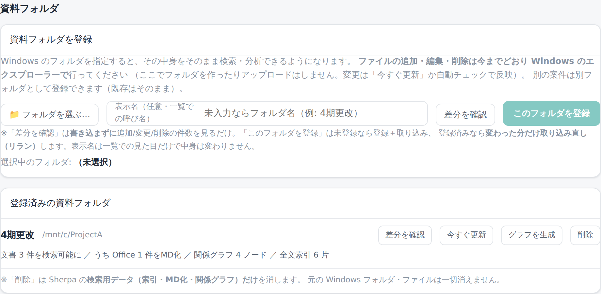
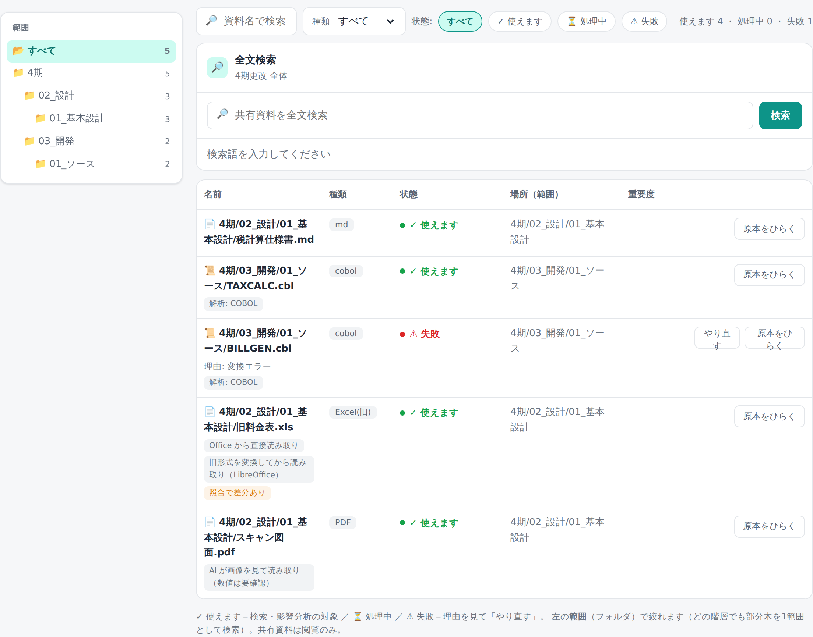

# 20. 管理：資料の取り込み

この画面は管理者向けです。操作には `admin` ロールが必要です。

## 考え方：ディレクトリの鏡

取り込みは「**置いた構造そのままが社内資料になる**」モデルです。

- **登録したフォルダ＝1つの資料フォルダ**。**フォルダ木がそのまま範囲**になります。
- **置いた構造をそのまま映す**: 更新すれば置き換わり、削除すれば消える。ただし反映は**自動監視ではなく、取り込み（登録／[取り込み開始]／再取り込み／「今すぐ更新」）の実行時**に行われます。
- **同一性＝パス**: 同名でも別フォルダなら別物として扱い、取り違えません。
- 登録フォルダは**読み取り専用**（システムは編集・移動・削除をしません）。
- **別のシステムは、登録するフォルダの直下に、システムごとのフォルダを分けて置いてください。** コードどうしのつながり（COPY・CALL など）、設計書などの文書から名前が同じコードへのつながり、影響の調査は、いずれも直下のフォルダをまたぎません（同じシステムのフォルダの中だけでつながります）。同じシステムの中の構成（サブシステムなど）は、そのシステムのフォルダの内側に置いてください。なお、範囲を絞らずに資料フォルダ全体で検索すると、複数のシステムが見つかります。1つのシステムだけを調べるときは、調べる範囲をそのシステムのフォルダに絞ってください。

つまり、整理されたフォルダを登録すれば、その整理がそのまま検索・影響分析の構造になります。

## 資料フォルダを登録する

「**資料**」画面の上部「資料フォルダ」で、取り込む対象フォルダを登録します（旧「資料を取り込む」画面を統合）。

- **Windows のフォルダ**（例: `C:\test`）を指定できます。内部では WSL のパス（`/mnt/c/test`）として読み取ります。
- 大量データは常時監視せず、**[取り込み開始]を明示**して走らせます。
- 登録すると、資料の読み取り、資料どうしの関係の確認、検索への登録が順に実行されます。

### 取り込む前に、ディスクの空きを確かめます

「このフォルダを登録」や「更新」を押すと、取り込みを始める前に、**取り込みに必要なディスクの空き**と**今の空き**を確かめて表示します。資料の数が多いと数えるのに少し時間がかかり、その間は「確かめています…（N 件を数えました）」と出ます。待ちたくないときは、5 秒たつと出る「待たずに始める」で、確かめずに進められます。

- 例: 「全文検索・つながりのデータ: 取り込みに必要な空き 約 12GB／今の空き 80GB（足ります）」。足りるときは何も聞かずに、そのまま取り込みが始まります。
- 保存先のディスクが複数に分かれているときは、ディスクごとに 1 行ずつ出ます（同じディスクに乗る分は合わせて数えます）。
- **「余裕が少ない見込みです」**（空きが必要な量の 1.2 倍に満たない）、**「足りない見込みです」**（空きが必要な量より少ない）のときは、注意を出して「それでも始める」か「やめる」かを選んでもらいます。始めても途中でディスクが足りなくなって止まるおそれがあるので、空きを増やしてからの取り込みをおすすめします。止めるかどうかはあなたが決めます。
- 「空きを確かめられません」と出たときは、その保存先のディスクの場所を読み取れていません（足りているという意味ではありません）。サーバーの管理者に、ディスクの空きを確認してもらってください。
- 更新では、今すでに使っている分は空きに含まれているので、**これから増える分**だけを見積もります。変更されたファイルが無いときは「追加のディスクはほぼ要りません」と出ます。
- 見積もりが失敗したときも、登録・更新はそのまま始められます。
- 見積もりは目安です。資料の中身（画像の多さ、表の行数など）で実際の大きさは変わります。取り込みを始めたときの見積もりと空きは、サーバーの記録（ログ）にも 1 行残ります。

### 取り込まれるもの

| 種別 | 扱い |
|------|------|
| 設計書・仕様（`.md` 等） | そのまま本文として索引 |
| ソース（`.cbl`/`.jcl`/`.cpy`） | 原文のまま（MD 化しない）。静的解析で呼び出し・コピー関係をグラフ化 |
| Office（`.xlsx`/`.docx`/`.pptx`） | **決定的に Markdown へ変換**して索引（**原本はそのまま保持**＝出典DLは原本を返す） |
| PDF（文字入り） | **既定で有効**な読み取り方式が文字を抽出して索引します（追加の準備は不要）。文字が少ない・埋め込みフォントで抽出が不十分な PDF は、管理者がシステム管理で「視覚読み取り」を足すと補われます |
| 画像ファイル（`.png`/`.jpg` 等） | 取り込み対象。**既定で画像の中の文字を読み取ります**（下記「画像の中の文字」）。さらに管理者がシステム管理で「視覚読み取り」（AI が画像を見て内容を説明する）を足すこともできます |
| 画像だけの PDF（スキャン） | 取り込み対象。文字層の無いページは**既定でページごとに画像化して文字を読み取ります**（下記「画像の中の文字」と同じ仕組み・読み取りワーカーが動いていることが条件）。さらに「視覚読み取り」を足すと AI が図表の内容も説明します |
| 旧形式（`.doc`/`.xls`/`.ppt`） | 既定は未対応。管理者がシステム管理で旧形式の変換（LibreOffice／Office 連携）を選ぶと、新形式に変換してから読み取られます |
| 圧縮ファイル（`.zip`/`.tar`/`.tar.gz`/`.tgz`） | **中身を展開して、普通の資料として取り込みます**（原本の圧縮ファイルは書き換えません）。出典は「圧縮ファイル名／中のファイル名」という形で表示されます |

> 版管理の記録のフォルダ（`.svn`・`.git`・`.hg`・`.bzr`・`CVS`）は資料ではないため、取り込みの対象にしません（中身は一覧・検索にも出ません）。
> Office のロックファイル（`~$` で始まる名前）と一時ファイル（`.tmp`・`.bak`・`.swp`・`.lock`）も、取り込みの対象にしません。

> Office の「写し（MD）」は検索のためのもので、**出典をクリックすると原本（元の Excel/Word）**が落ちます。利用者は写しを意識しません。圧縮ファイルの中身も出典をクリックすると、展開した写しがダウンロードされます。

### 圧縮ファイルで対応していないもの

- **パスワード付き（暗号化）**の zip は中身を取り込めません。パスワードを解除して保存し直してください。
- 圧縮ファイルの**中にさらに圧縮ファイルが入っている**場合、その中身は取り込みません（展開してから登録し直してください）。
- `.lzh`／`.7z`／`.rar` は対象外です。

### パスワード付きの資料

- パスワード付きの Word・Excel・PowerPoint（旧形式の `.doc`/`.xls`/`.ppt` を含む）と PDF は、中身を読めません。**資料名だけが検索に出て**、
  取り込み画面の「変換失敗」に理由「パスワード保護／暗号化」で載ります。ログ（`convert.log`）には
  「パスワード付きのため変換できません（中身は読めないので、資料名だけが検索に出ます）: ファイルの場所」の 1 行が出ます。エラーではありません。
- パスワードを外して保存し直すと、次の更新で普通に取り込まれます。「読み取り直す」でもやり直せます。
- ファイルが変わらない間は、更新のたびに調べ直したり変換し直したりしません。
- PDF の「開くときのパスワード」が無いもの（編集・印刷だけを制限しているもの）は、パスワード付きとは扱わず、普通に取り込みます。

### 旧形式（.doc/.xls/.ppt）の変換が終わらない・メモリを使いすぎる資料

- 旧形式は LibreOffice で新しい形式に直してから取り込みます。壊れていたり極端に重かったりして、**時間切れ**になるか、**LibreOffice 1 本のメモリの上限**（Linux のみ。ホストの全体のメモリの 15%・3GB〜4GB）を超えた資料は、
  その資料だけが失敗になり、取り込み画面の「変換失敗」に理由「タイムアウト」または「メモリの上限を超えた」で載ります（資料名だけが検索に出ます）。ほかの資料の変換は止まりません。
  ログ（`convert.log`）には「旧形式の変換が時間切れになりました」「旧形式の変換がメモリの上限を超えました（資料名だけが検索に出ます・原本が変わるまでやり直しません）: ファイルの場所」の 1 行が出ます。
- **原本が変わらない間は、更新のたびに読み取り直しません**（パスワード付きと同じです）。直してから保存し直すか、「読み取り直す」を押すと、やり直します。
  時間切れは、管理者が時間切れの設定を延ばしたときにも次の更新でやり直します。
- まとめて先に変換している最中にまとめ全体が失敗・時間切れ・異常終了したときは、`convert.log` に「旧形式の先変換のバッチが失敗しました（.doc 16件・理由: …）」の 1 行が出ます。
  そのあと 1 件ずつ変換し直し、原因の資料は上の 1 行で名前が分かります。
- 空きメモリが少ないとき（ホストの全体の 1 割か 1.5GB の大きい方を下回るとき）は、先読みと旧形式の先変換が、空くまで最大 2 分ずつ待ちます
  （取り込み画面の進み具合とログに「メモリの空きを待っています」と出ます）。それでも空かなければ並列を 1 つ減らして進めます。止まりはしません。

読み取り方式（アーム）の有効化・旧形式の変換方法の切り替えは管理者向けの設定です。詳しくは「[24. システム管理](24-システム管理.md)」を参照してください。

### 画像の中の文字

資料に貼り込まれた画面キャプチャや図の中の文字も、**既定で読み取って検索できるようにします**。
Word や Excel に貼った画像でも、画像ファイル単体でも同じです。

読み取った文字は「**補助の観測**」として、Office から機械的に取り出した確定値とは**別に**持ちます。
分けているのは、読み取りには必ず誤りが混じるからです。実測では、日本語の文章はほぼ正確に読める一方、
英数字の識別子で `Office` を `0ffice` と読むような取り違えが起きます。確定値と混ぜると、
その誤りが「資料にそう書いてある」ことになってしまいます。

縦書きの資料では、促音「っ」・長音「ー」・読点が落ちることがあります（実測: 「使って」→「使て」）。
横組みは同じ語でも正しく読めるため、縦書き特有の弱点です。

スキャンした大きな紙面は時間がかかります（実測: A4相当・1700×2501 の1ページで約5分）。取り込み自体は
すぐ終わり、読み取りは裏で進みます。

そのため、

- 検索・チャットの材料としては**使う**（画像の中の文字で資料に辿り着ける）
- 出典は**元の資料**（画像を貼った Word/Excel、または画像ファイルそのもの）
- 読み取り結果を**自動で直したりはしない**（原文のまま残す）

という扱いです。

WMF・EMF 形式の図（古い Office 文書に多い）は、画像として読むのではなく、図の中身から次の2つを取り出します。

- **図に書き込まれた文字**: 図の描画データに入っている文字そのものを取り出します。読み取りではないため誤読はなく、
  OCR の設定や進み具合にも左右されません。検索用の資料では図の直後に「図の中の文字（元の値）」として、
  人間向けの資料でも、その図を含む段落・表の直後（Excel は図の置かれたセルの近くの表の直後）に出ます。古い形式（.doc・.xls）の取り込み済みの資料は、変換結果が残っていれば次の更新で追随します。
- **図に埋め込まれた画像**: 画像（ビットマップ）が入っていれば、PNG にしてほかの画像と同じ読み取りに回します。
  結果は元の図の位置に、読み取り結果として出ます。

LibreOffice が入っている環境では、さらに図全体を絵として描き直して読みます。描き直しは取り込みや更新を待たせず、
アプリの裏で 1 件ずつ進めます（終わるまで「描画待ち」と記録され、終わると読み取り結果が出ます。同じ図は 1 回だけ描きます。対象は、画像が入っていない図、または文字が
ほとんど取れなかった図です。画像と文字が十分に取れた図は重複するため描き直しません）。結果は元の図の位置に、
読み取り結果として出ます。LibreOffice が入っていない環境では、描き直しが必要な図は
「未対応（LibreOffice が入っていません）」と記録されるだけで、失敗や再試行にはなりません（入れたあとは、アプリの裏の処理が自動で拾います）。描き直しに失敗した図も、理由つきで記録されるだけです。

止めたい場合は、`.env` に `SHERPA_OCR_ENABLED=0` を設定します。読み取りだけが行われなくなり、
取り込みと検索は通常どおり動きます。準備と運用は「[40. 運用](40-運用.md)」を参照してください。

## 取り込み状況を見る

「**資料**」画面の下部「取り込み状況」で、何が取り込まれたか・状態・範囲を確認します。

- **検索＋状態フィルタ**が主導線です。各資料が使えるか、処理中か、失敗したかが分かります（PDF・旧形式等の**未対応は一覧には載らず、件数で**表示）。
- **フォルダツリー**（範囲）を副導線として併設。クリックでその範囲に一覧を絞れます。
- 取り込み結果の要約に「**本文が読めず対象外 N 件**」が出ることがあります。文字として読めなかった（バイナリ・読み取り失敗・秘匿名で除外）ファイルの件数で、検索・grep・精読のどれからも対象外になっています。拡張子だけでは対象外にしません（対応していない拡張子でも、文字として読めれば検索・出典に使われます）。
- 状況は「**最後に最後まで終わった取り込み**」「**現在使える状態**」「**進行中の取り込み**」に分かれます。完了した取り込みの件数には、数えた時刻が付きます。進行中の結果は、仕上げが終わるまで完了欄へ加わりません。
- 件数が 0 のときも、使える機能とまだ使えない機能が表示されます。たとえば本文検索への登録が終わる前でも、文字として読める資料の本文を直接探せます。
- 取り込み中は「件数を数え直す」「更新」「AIで整える前の形に戻す」「削除」を押せません。ボタンの近くに理由が表示され、取り込みが終わると再び使えます。
- 前回の失敗、ディスクの空き不足、画像の中の文字を読む処理の停止、読み取れなかった資料の件数は、画面上部の「注意」にまとまります。
- 各文書は**原本DL**できます。物理パスは画面に出しません。
- うまくいかない時は**やり直す**（再取り込み）。再取り込みは資料フォルダ全体のクリーン再構築で、消えたファイルはグラフからも消えます。

### 取り込み中の進み具合

取り込みを実行している間は、上のスクリーンショットの画面に**5段のステッパー**が出ます。

1. **フォルダ確認**（対象フォルダの中身を数える）
2. **資料を読み取り中**（Office 文書などを検索できる形にする）
3. **資料どうしの関係を確認中**（ソース資料の呼び出し・コピー関係を確認する）
4. **検索できるように登録中**（検索用に本文を登録する）
5. **仕上げ**（後片付け・完了処理）

済んだ段は**✓**付きの薄い文字、いま処理中の段は**▶**（読み込み中マーク）と件数（分かっていれば「N/全体件数」、走査中でまだ全体数が分からないときは「N件確認済み」）で表示され、まだの段は薄い色のまま残ります。削除など上記以外の操作中は、この5段ステッパーではなく従来どおり処理内容が1行で表示されます。

各段の中で時間のかかる作業は、ステッパーの下に**「いまの作業」**として1行で出ます。

> いまの作業: 画像の中の文字を読む準備をしています・12000/48413件・経過 8分・最後に進んだのは 3秒前

- 件数を数えられる作業は「N/全体件数」、数えられない作業（台帳の行を作る、などの一つながりの処理）は名前と経過時間だけが出ます。
- 「最後に進んだのは」は、画面に出す記録が最後に更新された時刻です。数えられない作業でも、動いている間は1分弱ごとに更新されます。
- 最後に進んでから **10分以上**たつと、「この段は時間がかかることがあります（ログ: make l）」と出ます。止まったと決まったわけではなく、件数の多い資料フォルダでは1つの作業が長くかかることがあります。ログで動きを確かめる手順は [運用Runbook](41-運用Runbook.md) の「S12. 取り込みが止まって見える」を見てください。
- 出る作業の例（順番どおり）: 圧縮ファイルの中身の確認／前回の作りかけの片付け／資料を読み取る順序の準備／画像の中の文字を読む準備／資料の読み取り結果の反映／ソース資料の読み取り／資料どうしの関係の確認／資料一覧の保存／検索への登録／新しい検索結果への切り替え／古い検索用データの片付け／取り込み件数の集計。

### 困ったとき

- 文書が出ない場合は、登録したフォルダパスと（サーバーから見た）読み取り権限を確認します。
- Office 文書の内容が出ない場合は、資料の読み取り状態を確認します。
- 不要な資料が出る場合は、元フォルダから外して再取り込みします。
- 更新したのに反映されない場合は、再取り込みを実行したか、取り込みが失敗していないかを確認します。

## 資料の探し方を設定する（COPY の取り込み元の場所）

資料フォルダの画面の「**資料の探し方の設定**」で、管理者だけが次の 2 つを設定できます。

- **COPY の取り込み元の場所**: COPY（取り込み）の相手が、いちばん近い場所で 1 つに決まらないとき、ここに書いた場所を**上から順に**探し、最初に 1 つに決まった場所の資料を使います（1 行に 1 つ）。いちばん近い場所で決まるものは、設定より優先されます。
- **パスの別名**: 「別名 = 場所」の形で書きます。資料の中のパスの先頭が別名になっているとき（例: `inc/x.h`）、別名を場所に置き換えて探します。

場所は**資料フォルダの中からの相対パス**で、最上位のフォルダの下だけ指定できます（同じ最上位フォルダの中の資料にだけ使われ、別の最上位フォルダの資料へは線を引きません）。`..` や空の場所、別名どうしのぐるぐる回る指定は保存できません。資料フォルダの中に見つからない場所は、保存はできますが警告が出ます。

**保存すると、資料フォルダ全体を自動で取り込み直します**（設定が変わると、中身が同じでも全件を取り込み直すため、時間がかかります）。別の処理が実行中のときは、資料フォルダの状況に「資料の探し方の設定がまだ反映されていません（更新が必要）」と出続けるので、終わってから「更新」を押してください（画面を開き直しても出ます）。参照先のフォルダを付け替えても、この設定はそのまま引き継がれます（同じ案件のフォルダの付け替えとして扱います。付け替えのあとは、場所が新しいフォルダに実在するか警告で確かめてください）。取り込み直しが終わるまでの短い間は、検索の結果が古い設定のままの場合があります。設定がないときの動きは今までと同じです。

**知っておいてほしい制限（今の作り）**: 探す場所の一覧は**資料フォルダに 1 つ**で、その資料フォルダの全部のプログラムが同じ順番で探します。プログラムのまとまりごとに探す場所を変えることはできません。

- 部品がプログラムの近くにある形（例: `販売/プログラム` と `販売/部品`、`請求/プログラム` と `請求/部品`）は、いちばん近い場所で決まるので、設定を書かなくても正しくつながります。設定はこの決まり方を上書きしません。
- 困るのは、プログラムから見てどの部品の置き場所も同じくらい離れている形です（例: `プログラム/販売`・`プログラム/請求` と `部品/販売`・`部品/請求`）。ここで一覧に `部品/販売` を先に書くと、請求のプログラムも販売の部品につながります（**誤ったつながりになる**）。
- この形の資料は、**登録するフォルダの直下に、販売・請求など別のシステムのフォルダを分けて置いてください**（「別のシステムは直下のフォルダに分ける」の運用の決まり）。同じシステムのフォルダの中で探す場所を分けたい場合は、設定を書かずにおくと、決められない部品は「未解決」として表示されます（誤ってつながるより安全です）。

## 参照先を変える・削除する

- **参照先の変更（rebind・API 機能）**: 同じ資料フォルダの参照フォルダを別の場所に差し替えます（旧データは破棄して新フォルダから作り直し）。作り直しに失敗したときは、元の状態へ戻します。結果は取り込み画面の注意に出ます。戻せたときは「変更前の状態を保持しています」、戻すことにも失敗したときは「変更前の状態に戻せませんでした。「今すぐ更新」で作り直してください」と出るので、後者のときは「今すぐ更新」を実行してください。※現在は API（`POST /worlds/{id}/rebind`）として提供。画面の操作ボタンは未提供。
- **削除**: その資料フォルダの検索用データと資料どうしの関係を一括で消します。**登録元の外部フォルダ自体は消しません**。

> これらの操作で「消し残し（孤児）」が出ないよう、システムは取り込み・削除・起動の直後に**自動で整合（自己修復）**します。管理者が掃除を意識する必要はありません（[30-しくみ](30-しくみ.md) の「自己修復」）。

---

全文検索は → [21. 全文検索](21-管理-全文検索.md)。
ユーザー管理と監査ログは → [22. ユーザーと監査](22-管理-ユーザーと監査.md)。
