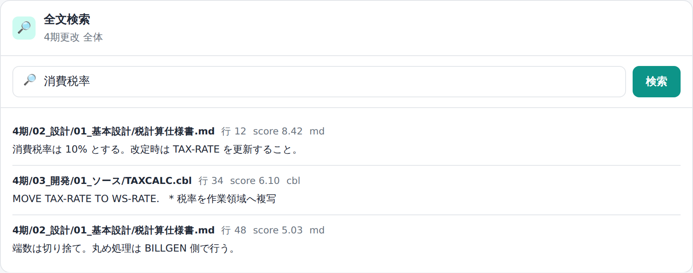

# 21. 管理：全文検索

取り込んだ社内資料は、**全文検索**で直接確認できます。
管理画面の操作には `admin` ロールが必要です。

## 全文検索（ES）

画面上部の「**資料**」を開くと、下半分の「取り込み状況」に「**資料の本文を検索**」パネルがあります。
検索語を入力欄（「共有資料を全文検索」）に入れて**検索**を押すと、取り込んだ社内資料を日本語で全文検索できます。

- 形態素解析（kuromoji）で**分かち書きした語句一致の全文検索**（BM25・関連度順）です。表記ゆれ・自然文に強い一方、この画面は語句一致だけを使い、言い換えに効く意味検索（ベクトル検索）は使いません。
- ヒットは**上位 20 件まで**で、1 件ごとに文書名・行・抜粋・スコア（`score`）・ファイルの種類を表示します。読み取り方（「Office から抽出」「PDF から抽出」など）や、照合で差分が見つかった資料（「照合で差分あり」）には小さな印が付きます。
- 検索の対象は、左のフォルダツリーで選んだ範囲です。パネルの見出しの下に、今の範囲（「範囲: …」または資料フォルダ全体）が出ます。範囲を変えると、検索語が入っていれば新しい範囲で検索し直します。
- 物理パスは出さず、文書名（相対パス）だけを表示します。秘匿として扱うファイル名の資料は、取り込み済みでも結果に出ません。
- 要求がエラーになったときは、「検索できません」と理由が表示されます。全文検索のサービスに接続できないときは「全文検索のサービスを使えません」と表示されるので、「システム状態」を確認してからもう一度お試しください。「該当するヒットはありません」は、検索が成功して一致が無かったときだけ表示されます。

---

ユーザー管理と監査ログは → [22. ユーザーと監査](22-管理-ユーザーと監査.md)。
中で何が起きているか（しくみ）は → [30. しくみ](30-しくみ.md)。
