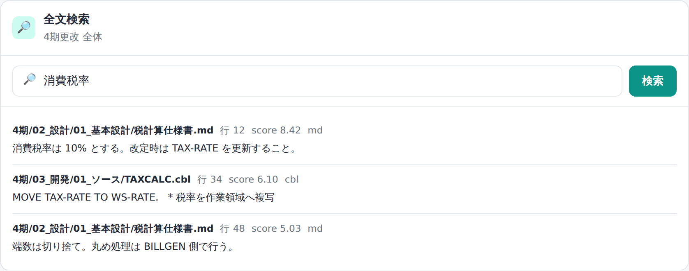

# 21. 管理：全文検索

取り込んだ社内資料は、**全文検索**で直接確認できます。
管理画面の操作には `admin` ロールが必要です。

## 全文検索（ES）

「**取り込み状況**」画面の**全文検索パネル**で、社内資料を日本語全文検索できます。

- 形態素解析（kuromoji）で**分かち書きした語句一致の全文検索**（BM25・関連度順）。表記ゆれ・自然文に強い（言い換えに効くベクトル検索は、埋め込みを有効にした環境でのみ）。
- ヒットは **文書・行・抜粋・スコア**で返り、左のフォルダツリーで選んだ範囲に絞れます。
- 物理パスは出さず、文書名（相対パス）だけを表示します。

---

ユーザー管理と監査ログは → [22. ユーザーと監査](22-管理-ユーザーと監査.md)。
中で何が起きているか（しくみ）は → [30. しくみ](30-しくみ.md)。
