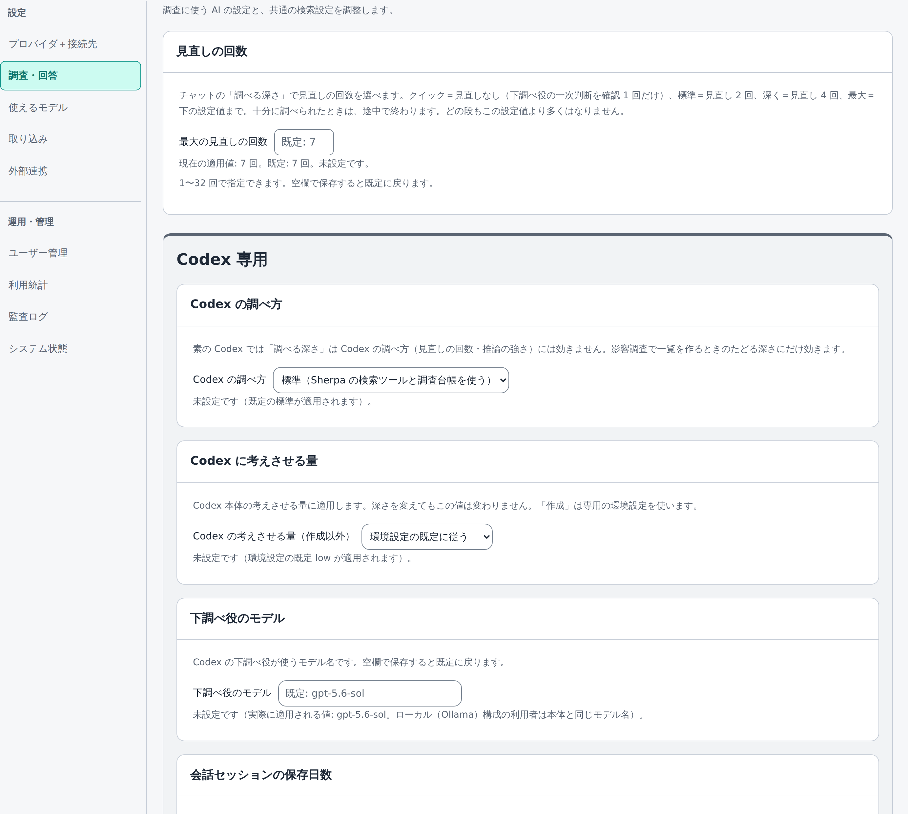

# 24. システム管理

「**システム管理**」画面（`admin-settings.html`）は、**全ユーザーに効く設定**と、管理系画面への入口です。
`admin` ロールが必要です。自分だけの設定（頭脳・自分のAPIキー・Ollama の接続先・表示）は
「[13. 個人設定](13-個人設定.md)」で行います。



画面の左には項目の一覧があり、「**設定**」（プロバイダ＋接続先・調査・回答・使えるモデル・取り込み・外部連携）と
「**運用・管理**」（ユーザー管理・利用統計・回答への評価・監査ログ・システム状態・つながりの確認）に分かれています。
設定の変更は、どの項目で行っても画面下の「**保存**」（`Ctrl+S`、Mac は `Cmd+S` でも可）でまとめて保存されます。まだ保存していない変更がある項目には、一覧の項目名の横に丸い印が付きます。

項目単位の一覧（何をする設定か・既定値・変えるとどうなるか）は「[25. 設定リファレンス](25-設定リファレンス.md)」に
まとめています。このページは画面の使い方・考え方の説明です。

## 全体設定の考え方

全ユーザーに効く設定は「**全体設定**」として DB に保存されます。優先順は次のとおりです。

**全体設定（system_settings） ＞ アプリの既定値**

画面で変えられる項目は、この画面だけが設定の正です。環境変数は**初回起動時に一度だけ**この画面へ
取り込まれ、以後は読まれません（env を書き換えても2回目以降の起動には効きません）。各項目は、
この画面で明示的に変更しない限りアプリの既定値に従います。項目の下には「**既定に従っています**」または「**未設定です**」
（＝既定のまま）か、「**この値で固定中です**」（＝全体設定で明示的に変更済み。「この一覧で」「この選択で」「この設定で」「この AI で」と書かれる項目もあります）が表示されます。
各タブの下にある「**このタブを既定に戻す**」を押すと、そのタブの項目の全体設定を消して既定へ戻します
（API キーは対象外で、キー欄の「キーを削除」で個別に消します。「プロバイダ＋接続先」タブの場合はチャットの質問例も既定へ戻ります。質問例だけを戻すときは、その項目の「未設定に戻す」を使います）。
個人キーの許可や利用者のキー発行を許可しているタブで既定に戻すと、許可が OFF に戻り、保存済みの個人キー・利用者発行キーが削除・失効するため、確認が出ます。

変更は保存と**同じトランザクションで監査ログに記録**されます。記録に失敗した場合は保存そのものを取り消します
（**fail-closed**＝「変更されたのに記録が残らない」状態を作りません）。誰が・いつ・何を変更したかは
「[22. ユーザーと監査](22-管理-ユーザーと監査.md)」の監査ログで確認できます。

**初回起動時に env から取り込まれる項目**: 下の「AIプロバイダ（クラウド）」欄（キー・接続先・個人キーの許可・
Web 検索の許可）、「使えるモデル（モデルカタログ）」の OpenAI 埋め込みモデル既定（env `OPENAI_EMBED_MODEL`）、
Ollama の既定接続先、調べる深さの基準値、同時実行の上限、取り込みの読み取り方式、旧形式の変換、
個人ファイルの上限と保持日数です。一度起動した後は、この画面（管理画面）が唯一の管理場所です。

## AIプロバイダ（クラウド）

クラウドの AI は OpenAI（Azure OpenAI を含む）です。ローカル AI（Ollama）はいつでも併用できます。

- **プロバイダの選択**: クラウドの AI は OpenAI の1つです。以前に Gemini や AWS Bedrock を選んで
  保存していた場合、それらは現在使えないため「未選択」として扱われ、この画面に警告が出ます。OpenAI
  を選び直して保存してください（Gemini・AWS Bedrock を選んで保存しようとすると拒否されます）。
- **接続テスト**: 入力中のキーで1回だけ接続を試せます（保存はしません）。
- **利用者ごとの個人キーを許可する**（既定 OFF）: OFF のときは、この画面の中央キーだけが使われます。
  利用者の「個人設定」画面には API キーの入力欄が出ません（「キーは管理者が設定します」という案内が
  代わりに表示されます）。**OFF で保存すると、既に保存済みの利用者の個人キーはすべて削除されます**
  （OFF の間は個人キーを保存しない、という状態を保つため）。ON にすると、利用者は自分の API キーを
  「個人設定」で入力・優先利用できます（利用者ごとに課金元を分けたい場合など）。個人にはキーを
  発行しない、という既定の運用方針に沿って OFF を推奨します。
- **Web 検索を許可する（Codex のみ）**（既定 OFF）: ON にすると、チャットの AI が「Codex 調査（OpenAI）」の利用者が、チャット画面のやりたいことブロック（「参照する」行）で会話ごとに Web 検索を ON/OFF できます。OFF のときはその行自体が出ません。外部に送られるのは調べものの検索語だけで、社内資料そのものは送られません。接続先が Azure OpenAI など OpenAI 本家以外のときは、この設定に関わらず Web 検索は使えません。
- **ローカル AI（Ollama）の接続先**: クラウドの選択に関わらず使える、社内のローカル AI の既定の接続先です。
  別のパソコンの Ollama を使うときは、そのパソコンの名前か IP アドレスで入力します（例: `http://192.168.0.10:11434`）。
  下の「利用者が選べる接続先」への登録は要りません。相手のパソコンでは、ほかのパソコンからの接続を受け付ける設定
  （環境変数 `OLLAMA_HOST=0.0.0.0`）で Ollama を起動し、ポート 11434 への接続を許可しておきます。
- **接続テスト**（Ollama の接続先の横）: 入力中の接続先で1回だけ接続を試せます（保存はしません）。届いたときは
  相手のパソコンで取得済みのモデルと、「使えるモデル」に登録した Ollama のモデルのうちまだ取得されていないものを表示します。
  届かないときは、拒否された（相手で Ollama が起動していない・`OLLAMA_HOST=0.0.0.0` で起動していない）、
  時間切れ（ファイアウォールでポートが閉じている）、名前からパソコンを見つけられない（IP アドレスで入力する）などの手がかりを表示します。
- **埋め込みの接続先**: 検索用のベクトル（埋め込み）を、回答と同じクラウド（既定）で作るか、ローカル（Ollama）で作るかを選びます。ローカルにすると API の費用はかかりませんが、時間はかかります。切り替えると検索用のベクトルをすべて作り直すため、各資料フォルダで「今すぐ更新」を実行してください（実行しなくても、次の取り込み・更新のときに作り直されます）。使うモデルは「使えるモデル」の Ollama の埋め込み欄で決めます。
- **利用者が選べる接続先**（「詳細設定」を開くと出る許可ホスト一覧）: 利用者の「個人設定」で、既定の接続先とは別に選ばせたい Ollama 接続先を、
  1行1つの `host:port` 形式で登録します。既定の接続先と `localhost` は登録しなくても使えるので、
  ほかに選ばせる接続先がなければ空のままで構いません。ここに登録していない接続先は、利用者が
  個人設定で選ぼうとしても保存できません（誤って社外／無関係なホストへ接続しないための許可制）。

## 同時実行の上限

「プロバイダ＋接続先」タブの「同時実行の上限」カードで、チャットで送信した質問（回答を作っている最中のもの）を同時にいくつまで受け付けるかを決めます。

- **同時に実行できる質問の数（1 人あたり）**: 既定 2・範囲 1〜16。
- **同時に実行できる質問の数（全員の合計）**: 既定 8・範囲 1〜64。

上限に達したときは待たされず、その場で「実行中の回答が終わってからもう一度お試しください」という案内になります。値を大きくすると同時に投げられる質問は増えますが、単一 worker のメモリ・API 呼び出し量への負荷が増えます。空欄で保存すると既定に戻ります。

## 調査・回答

チャットの頭脳は「**Codex 調査**」と「**簡易**」の2つだけです（[11. 範囲とAIの切り替え](11-使い方-範囲とAI.md)）。「調査・回答」タブの設定は、主に Codex 調査の調べ方を決めます。簡易は固定の上限（AI への往復 3 回・1 往復あたり道具 4 回）で動くため、このタブの設定では変わりません。

タブは「Codex 専用」「取り込み・検索の共通設定」「Codex の資料検索・関係探索」の三つの区画に分かれています（区画の名前は画面のままです）。

- **見直しの回数**: 「調べる深さ」が決める見直しの回数（クイック 0・標準 1・深く 3・最大 6）。Codex 調査（OpenAI）の既定の方式で、調査計画書を見直す回数の上限として働きます。「最大の見直しの回数」（既定 7・範囲 1〜32）はこの既定の方式には効かず、調査計画書を使わない構成（Codex 調査（Ollama）、または評価用の `SHERPA_LEDGER_STYLE=json`）で、下調べ役の結果を見直す回数にだけ効きます。その構成の回数はクイック 0・標準 2・深く 4・最大はこの値までで、標準・深くもこの値で頭打ちになります。
- **Codex の調べ方**: 「標準」は Slouch の検索ツールで調べ、調査計画書を書きながら答えます（Codex 調査（Ollama）では調査計画書は使いません）。「素の Codex」は Codex が自分で資料を読む試験用の方式で、見直しや調査計画書は使いません。「調べる深さ」は、影響調査で一覧を作るときのたどる深さにだけ効きます。
- **Codex に考えさせる量**（画面の項目名は「Codex の考えさせる量（作成以外）」）: 通常の調査の推論レベルの基準値（既定は `medium`）。検索件数やツール実行回数の指定ではありません。「作成」の標準は専用の環境設定を使います。調べる深さが「クイック」のときだけ自動で 1 段下がり、それ以外の深さでは変わりません。
- **下調べ役のモデル**: Codex が観点ごとの下調べに使うモデルの名前です。空欄なら接続先に応じた既定が使われます。
- **会話セッションの保存日数**: Codex が会話を続けるために持つ記録の保存日数です（既定 30 日・0 で無制限）。
- **取り込み・検索の共通設定**: 埋め込みの同時送信数（資料の取り込み）と、Codex が検索ツールから受け取る結果1件あたりの情報量の上限です。
- **Codex の資料検索・関係探索**: 資料を探す件数・読む行数・たどる段数の基準値です。実際に効くのは **Codex 調査**で、Codex に渡す検索ツールの件数・読む行数（資料検索のヒット件数・前後の行数）と、影響分析・原因調査・内容の質問で最初に行う検索（たどる段数・ヒット件数）です。簡易には効きません。

チャットの「クイック／標準／深く／最大」の選択では、画面に保存した基準値自体は変わりません。ただし実際に使う値は深さで変わります（検索件数・読む行数には固定の倍率、たどる段数には固定の加算、Codex に考えさせる量にはクイックだけ 1 段下げる調整が掛かります（素の Codex と `low` 以下は下がりません）。倍率・加算は [25. 設定リファレンス](25-設定リファレンス.md) の表のとおり）。
設定は次に開始する調査から適用され、空欄で保存するとアプリの既定値に戻ります。

「このタブを既定に戻す」は調査設定だけを戻します。接続先タブのリセットでは調査設定は変わりません。
項目別の既定値・変更の目安は「[25. 設定リファレンス](25-設定リファレンス.md)」の「タブ: 調査・回答」を参照してください。

## 個人ファイル（作業領域）

「プロバイダ＋接続先」タブの「個人ファイル（作業領域）」カードで、利用者が自分の作業領域へアップロードするファイルと、
Codex が作成した成果物の扱いを決めます（[12. ログイン・共有・個人ファイル](12-使い方-ログイン共有個人ファイル.md)）。

- **1 件あたりのアップロード上限（MB）**: 1 ファイルの大きさの上限です（既定 10MB・範囲 1〜1024MB）。超えるとアップロードは断られます。
- **保持日数**: 保存から何日たったら自動で削除するかです（既定 90 日・範囲 0〜3650・0 は無期限）。変更は新しく保存するファイルから適用されます。

空欄で保存すると既定に戻ります。

## チャットの質問例（クイック入力）

チャット画面を開いたときに表示される、クリックで入力欄に読み込める質問例チップです（同じ
「プロバイダ＋接続先」タブ）。一度も設定していなければ組み込みの既定（4例）が表示されます。導入先の業務に
合わせた例文に差し替えたいときに使います。

- **質問例を表示する**（既定 ON）: OFF にすると、下欄の内容にかかわらずブロック自体が表示されなくなります。
- **質問例**（1行に1つ・最大8件・各200文字まで）: 空欄の行は無視されます。入力した文言・順序が
  そのままチャット画面に表示されます。**「質問例を表示する」が ON のまま欄を空にして保存すると、質問例は何も表示されません**（組み込みの既定には戻りません）。
- 「未設定に戻す（組み込みの既定を使う）」で、この項目だけを組み込みの既定（4例）に戻せます。

## 使えるモデル（モデルカタログ）

実際に使われるモデル名は、利用者側の自由入力ではなく**ここで登録した一覧（既定）**で決まります。
表は縦に「用途」
（接続テスト用・検索用文書の整形など）、横に「プロバイダ」（選択中のクラウド AI・ローカル AI（Ollama）・Codex）を
並べた1枚表で、選んでいないクラウド AI の列は出ません。行は「接続テスト用」「依頼の仕分け」「検索の索引づくり」
「簡易回答のモデル」「Codex」「検索用文書の整形」です。

- 各セルは「選べるモデル名の一覧」と「既定（実際に使われるモデル）」を持ちます。既定はセルの選択欄で選び、
  一覧は横の「一覧を編集」（1行に1つ・**反映**で確定）で直します。「このタブを既定に戻す」で組み込みの一覧・既定へ戻せます。
- 保存できるモデル名には共通の文法（英数字で始まり `. _ : / -` のみ・128 文字まで）があります。
  Codex 用の欄はさらに短い上限（64 文字まで）があります。CLI へそのまま渡す文字列の
  ため、ここで拒否される値は Codex では常に使えません。
- ここで「既定」を変更して**保存**すると、次回以降すぐにその値が使われます（利用者側に個別の選択欄は
  なく、切り替えの操作は不要です）。
- この表にない設定は別のタブにあります。視覚読み取りの AI は「取り込み」タブ、下調べ役のモデルは「調査・回答」タブ、簡易回答に使う AI は「外部連携」タブ、埋め込みの接続先は「プロバイダ＋接続先」タブです。

## 取り込み設定（資料の読み取り方）

「取り込み」タブで、資料フォルダの文書をどう読み取って検索・グラフの対象にするかを、**アーム**（読み取り方式）単位で選べます。
チェックを変えても既存の取り込み済みデータはすぐには変わらず、**次回の取り込み・再取り込みから反映**されます。読み取り方式を変えると、次の同期で全資料の作り直しになります。

| アーム | 何をするか | 既定 |
|--------|-----------|------|
| Office 文書から直接読み取り（`ooxml`） | Word/Excel/PowerPoint を直接テキスト化します。値の権威（数値や表はここが正）。 | 有効 |
| PDF の文字を抽出（`pdf_text`） | PDF に埋め込まれた文字を抽出します。画像だけの PDF（スキャンした紙資料など）は、この方式だけでは文字が取れません（OCR や視覚読み取りが有効なら読める場合があります）。 | 有効 |
| 画像・スキャン文書を AI が見て読み取り（視覚読み取り）（`vision`） | 画像・スキャン文書を AI（視覚モデル）が実際に「見て」読み取ります。文字がほぼ無い PDF・スキャン画像に効きます。 | 無効（任意で追加） |

※ 「文書を広く読み取り（`markitdown`）」は廃止しました（2026-08・変換を `ooxml` に一本化）。画像の中の文字は、
上のアームとは別に **OCR（既定で有効・[40-運用](40-運用.md)）**が読み取ります。

読み取りに使うソフト（Office/PDF 抽出用のライブラリ）は最初から同梱されているため、
「Office 文書から直接読み取り」「PDF の文字を抽出」は**追加の準備なしにそのまま動きます**。

**どういう資料でどれを足すか**の目安:

- 文字が少ない・埋め込みフォントで抽出が不十分な PDF、スキャンした紙資料・画像しかない PDF・写真として
  保存された資料 → **「視覚読み取り」を追加**（使う AI は下の「視覚読み取りの AI」で設定します）。
- チェックを**すべて外すと「未設定」に戻ります**（標準の Office 直接読み取り＋PDF 文字抽出に戻ります）。

**視覚読み取りの AI**（チェックの下に表示）: 視覚読み取りで使う AI を選びます。Ollama は「プロバイダ＋接続先」タブの既定接続先を使い、
接続先が IP アドレスでも名前でも、クラウド利用の許可は要りません。今の接続先は画面に表示されます（画像はその接続先の Ollama へ送られます）。
クラウド（OpenAI）は、許可のチェックを入れたときだけ使えます（キーは「プロバイダ＋接続先」タブで設定します）。
AI やモデルを変えると、次の同期で全資料の作り直しになります。

**画像の文字の読み取り（OCR）**（「取り込み」タブのカード）: 状態の表示だけで、スイッチはありません。状態は「稼働中」「.env で停止中」
「有効だが読み取りのワーカーが動いていない」のどれかです。視覚読み取りは AI モデルに画像を読ませて取り込み中に実行しますが、OCR は
AI モデルの選択が無く、別のワーカーが後から読み取ります。使う・使わないは `.env` の `SHERPA_OCR_ENABLED` で決め、変えると次の同期で全資料の作り直しになります。

取り込み対象の全体像・「使えます／未対応」の表示は「[20. 資料の取り込み](20-管理-取り込み.md)」を参照してください。

## 検索用文書の読みやすい整形（AI 成形・任意）

取り込んだ資料は既定でそのまま検索・回答に使われます。これとは別に、**AI に検索用の文書を読みやすく
自動整形させる**任意のオプションがあります（**既定 OFF**）。

- オンにすると、資料の取り込み後にバックグラウンドで自動整形が走り、**利用料が発生します**。
- オフのままでも検索・チャットの回答は通常どおり動きます（整形前の内容で検索します）。
- 使う AI・モデルは「使えるモデル（モデルカタログ）」の「検索用文書の整形」欄で設定します。
- 実測では、整形の効果は「です・ます調への統一」「余白の削除」などの**文体の整形にとどまり、情報の
  追加や欠落の復元はありません**。コストに見合うかを踏まえて、必要な場合だけ有効にしてください。
- **ナレッジグラフ（影響分析）はこの整形と無関係**です。グラフは資料の構造をそのまま静的に解析して
  作られ、AI は使いません。

## Codex の調査で受け取る情報量

「調査・回答」タブの「取り込み・検索の共通設定」区画で、Codex が検索ツールから受け取る結果1件あたりの上限を KB 単位で設定します。
この上限は Codex 調査の内部実行に働きます（Codex 側にも固定の上限があり、小さい方が使われます）。
「前後の行数」は読む範囲、この設定は結果のデータ量を制限します。行数の範囲内でも、情報量の上限で切り詰める場合があります。

モデルが一度に読める分量（コンテキスト上限）は AI 自身に判断を任せており、Slouch 側での登録や調整は不要です。

既定値・変更の目安は「[25. 設定リファレンス](25-設定リファレンス.md)」の一覧（「タブ: 調査・回答」の節）を参照してください。

## 旧形式（.doc / .xls / .ppt）の変換

「取り込み」タブの「詳細設定」を開くと出る設定です。古い Office 形式（拡張子が `.doc` / `.xls` / `.ppt` の資料）は、そのままでは①の「Office 文書から直接読み取り」で
扱えません。新しい形式（`.docx` / `.xlsx` / `.pptx`）へ**変換してから**読み取るため、変換の方法（バックエンド）を選びます。

| 選択肢 | 何をするか |
|--------|-----------|
| **使わない**（既定） | 古い形式のファイルは読み取り対象にしません。 |
| **LibreOffice で変換** | 追加ソフト（LibreOffice）だけで変換します。設定は要りません（LibreOffice がこのパソコンに入っていれば動きます）。図の配置が少しずれることがあります。 |
| **Office 連携** | 本物の Office（Word/Excel/PowerPoint）を自動操作して変換します。最も忠実です。**同じ Windows パソコンに Office が入っていれば、追加設定なしでそのまま使えます**（既定の動き方）。別のパソコンの Office を使う場合だけ、そちらでの起動作業（ワーカー）が必要です。 |

選べない選択肢は、変換の準備がまだ整っていないことを意味します（例: LibreOffice が見つからない、Office 連携の準備が
見つからない）。画面にその理由と対処が表示されます。なお Office 連携は、同じパソコンでの直接連携が見つかれば
選択できますが、実際に変換できる種類（.doc/.xls/.ppt）は Windows 側で見つかった Office アプリ
（Word/Excel/PowerPoint）の範囲に限られます。

技術的な準備手順（ワーカーの起動・接続確認など）は「[40. 運用・デプロイ](40-運用.md)」の
「旧形式（.doc / .xls / .ppt）の変換 — Office 連携」を参照してください。

## 必要な道具（入っているかの確認）

「取り込み」タブの「必要な道具」の表で、アプリが使う外部の道具（LibreOffice・OCR ワーカー・スライド変換ツールと
Chromium・Codex 一式など）がこのサーバーに入っているかを確認できます。入っていない道具は「入っていません」と表示され、
その道具に頼る機能（表の「使う機能」）は使えません。「入れ方」の列に、入れるための一行の手順が出ます。
LibreOffice が入っていない間は、上の「LibreOffice で変換」は選べず（理由つき）、API から保存しても拒否されます。
同じ内容は `./sherpactl doctor` でも確認できます（入っていない道具は NG でなく SKIP として表示します）。

## 視覚読み取りの AI（VLM）

上の「視覚読み取り」アームが使う AI を、「取り込み」タブの「詳細設定」で設定します（「視覚読み取りの AI」）。

- **使う AI**: 「**ローカル（Ollama）**」（既定）か「**クラウド（OpenAI）**」を選びます。
- **モデル名**: 既定は `qwen2.5vl`（日本語含む文書の読み取りに強いモデル）。ローカルを使う場合は
  そのパソコン（または社内ネットワーク上）で事前にモデルを用意しておく必要があります。
- **接続先**は専用の欄を持たず、上の「ローカル AI（Ollama）の接続先」を使います。社内ネットワークの Ollama を
  使う場合も、そこに入れた接続先（IP アドレスでも名前でも）へそのまま送ります（「クラウド AI の利用を許可する」は要りません）。

### クラウド（OpenAI）を使う場合の注意

「**クラウド AI（OpenAI）の利用を許可する**」を明示的にオンにしない限り、クラウドを選んでも**画像は一切外部に送信されません**
（視覚読み取り自体が行われません）。許可すると、画像がそのまま外部の AI（OpenAI）に送信されます。機密資料を扱う場合は
特にご注意ください。

**クラウド利用の可否は、この展開（プロジェクト・導入先）ごとに管理者が決める安全側の設定**です。既定はオフ
（＝送信禁止）ですが、業務上必要であれば有効にして構いません。変更は他の全体設定と同じく監査ログに記録されます。

クラウドを選んでいるのに OpenAI の API キー（`OPENAI_API_KEY`）が未設定の場合は、画面に案内が表示され、
キーが設定されるまで視覚読み取りは行われません。

## 接続先を Azure OpenAI にする

チャット・検索・検索用文書の整形などに使う「OpenAI」の接続先は、既定では OpenAI 本家（`api.openai.com`）ですが、
Azure OpenAI（または他の OpenAI 互換エンドポイント）へ切り替えられます。**設定はこの画面
（「プロバイダ＋接続先」タブの「AIプロバイダ（クラウド）」カード内の「OpenAI の接続先」欄）で行います**。DB（`system_settings`）が
唯一の管理場所で、変更は**再起動不要**で即座に反映されます。

「OpenAI の接続先」欄で選べる種類:

- **OpenAI 本家**（既定）: 他の入力欄は不要です。
- **Azure OpenAI**: 接続先 URL（例 `https://<リソース名>.openai.azure.com/openai/v1`）・認証ヘッダ形式・
  API バージョン・埋め込みのデプロイ名を入力します。
- **その他 OpenAI 互換**: 独自ホスト名等、host だけでは Azure と判定できない構成向けです。

| 入力欄 | 内容 |
|-----|------|
| 接続先 URL | 既定は空（OpenAI 本家）。Azure なら `https://<リソース名>.openai.azure.com/openai/v1`。`https://` のみ許可・ユーザー情報やクエリは含められません。 |
| 認証ヘッダ形式（「詳細設定」を開くと出ます） | 既定 `Bearer`（`Authorization: Bearer <キー>`）。本リポジトリの実機では Bearer で疎通確認済みです。Microsoft 公式の Azure API キーの例は `api-key` ヘッダを使うため、環境によってはそちらへの切り替えが必要なことがあります（既定でつながらなかったときに試してください）。 |
| API バージョン（同じく「詳細設定」） | 既定は空（付けない）。上の URL のように末尾が `/openai/v1` の Azure **v1 API** では不要です。旧方式のエンドポイント（`/openai/deployments/<デプロイ名>/...`）を使う場合だけ、Azure が発行する API バージョン文字列（例 `2024-10-21`）を設定してください。 |
| 埋め込みのデプロイ名 | 「使えるモデル」（モデルカタログ）の openai/embed 欄と同じ値です（別の保存先ではありません）。次元（1536）は変わりません。 |

「本家」以外を選ぶと接続先 URL が必須になります（空のままでは保存できません）。「その他 OpenAI 互換」では、接続先 URL のホストが私有アドレス（社内のネットワーク）や社内向けの名前ならチャット画面に「社内サーバ」、公開ホストなら「クラウド（OpenAI 互換）」と表示されます（URL の書き方だけで判定し、名前の解決はしません）。「本家」へ戻すと
他の入力欄は無視されます（値が残っていても、実際の接続には使われません）。「接続テスト」ボタンで、
**保存する前の入力中の値**のままその場で1回だけ試せます（保存はしません）。

`OPENAI_API_KEY`（中央キー）の設定方法自体は変わりません（Azure の場合はそのキーを設定します）。
Azure OpenAI を使う場合は、**埋め込み用のデプロイ**（`text-embedding-3-small` 相当・1536次元）も
あらかじめ作成しておいてください。無いと検索の索引作成（ベクトル埋め込み）が動きません。

**Codex（調査・作成系）の Web 検索は、Azure OpenAI 接続では自動的に無効になります**（現在の
Slouch＋Codex 構成でこの接続先でも正しく動くかが未検証のためです。Azure OpenAI 自体が Web 検索に
対応していない、という意味ではありません）。

利用者側（個人設定画面）には、この接続先が**読み取り専用**で表示されます（種類とホスト名のみ・
キーやパスは表示しません）。「本家」以外を選んでいるときだけ、OpenAI の API キー欄の近くに
表示されます（個人設定にモデル欄はありません）。

### env は初回起動時のシードのみ

`OPENAI_BASE_URL`・`SHERPA_OPENAI_AUTH_HEADER`・`SHERPA_OPENAI_API_VERSION`・
`SHERPA_OPENAI_ENDPOINT_KIND`・`OPENAI_EMBED_MODEL` は、`.env.example`
のテンプレには載せていない（鍵・接続先は管理画面で設定する運用のため）が、env に書けば**初回起動時に
一度だけ**この画面（と「使えるモデル」の openai/embed 欄）へ取り込まれ、以後は読まれません
（上の「全体設定の考え方」の例外と同じ）。**2回目以降の起動では env を書き換えても効きません**
＝この画面が唯一の管理場所です。新規導入時にあらかじめ Azure 用の値を `.env` へ書いておけば、
初回起動時にこの画面へ自動で反映されます。

### 疎通を確かめる（導入前の候補値・env ファイル）

**この画面の「接続テスト」ボタンは、保存する前の入力中の値をその場で1回だけ試す方法です**
（起動中のアプリに対して行う・上に書いたとおり）。

一方、`make azure-smoke` は**まだこの画面にも env にも入れていない候補の値**（例: 新規導入時に
初めて Azure の情報を試す場合）を、`--env-file` で渡した一時ファイルだけを使って確認する別のツール
です。実行中のアプリの DB 設定は一切読みません（起動する前・導入時の下調べ用）。

```
make azure-smoke ARGS="--env-file azure.env --yes"
```

- `--env-file azure.env` は、本番の `.env` を汚さずに Azure 用の設定だけを別ファイル
  （例 `azure.env`）にまとめて渡す使い方です（`.env` を編集済みなら省略してかまいません＝
  既定で `.env` を読みます）。
- `--yes` を付けないと、実 API を叩く前に確認が入ります（課金が発生するため）。
- まず設定だけを確認したいときは `--yes` の代わりに `--dry-run` を付けてください。**通信せず**、
  解決した接続先・ヘッダ形式・モデル欄に何を入れるべきかだけを表示します。

確認できる内容: 設定の解決（通信なし）／通常のチャット応答／ストリーミング応答／チャット検索が
使うツール呼び出し／埋め込み（次元が 1536 であること）／Responses API（Codex(OpenAI) 構成が
使えるか）。画像入力・Codex CLI 経由の確認は既定では行わないため、必要なら `--vision` /
`--codex` を付けてください。

結果は項目ごとに OK/NG と、落ちた項目があれば「次にやること」（デプロイ名を直す・
`SHERPA_OPENAI_AUTH_HEADER=api-key` にする・`SHERPA_OPENAI_API_VERSION` を入れる 等）を表示します。
Azure 側のコンテンツフィルタでブロックされた場合もそれと分かる表示になります。詳しい引数は
`.venv/bin/python scripts/azure_smoke.py --help` を参照してください。

デプロイを作成した直後は、Azure 側の反映に時間がかかることがあります。この間は設定が正しくても
「デプロイが見つからない」（`DeploymentNotFound`）というエラーが出ることがあります。数分待って
から、もう一度お試しください。それでも改善しない場合は、デプロイの種類（グローバル標準／標準 など）
を変えて作り直すと安定することがあります。

## 外部連携（API キー）

他のアプリ（Dify 等）からこの Slouch の検索・変換を呼び出すための API キーを、この画面で
発行・一覧・失効できます。

- **発行**: ラベル・対象フォルダID（任意・空欄で全て）・この日まで有効（任意・空欄で無期限）・
  1日あたりの呼び出し上限（任意・空欄で無制限）・Webhook URL（任意・下記「Webhook 通知」参照）
  を指定して**発行**します。呼び出し回数は、発行後の最初の呼び出しから 24 時間ごとの枠で数えます（サーバーを再起動するとカウントはリセットされます）。**キー本体は発行直後の1回だけ表示されます**（以後は再表示できません・
  控えを保管してください）。紛失した場合はそのキーを失効させて発行し直してください。
- **一覧**: ラベル・キーの識別部分・対象フォルダ・発行者・作成日・最終利用・呼出数（30日）・
  期限・Webhook 登録の有無・状態を確認できます。利用者が自己発行したキーも同じ一覧に含まれ、
  管理者はどのキーも失効できます。

### Webhook 通知

取り込み（登録・更新・参照先変更・再取り込み・削除）が完了・失敗するたびに、キーごとに登録した
URL へ通知（HTTP POST）を送れます。チャットや `GET /worlds/{world_id}/status` でのポーリングを
省き、完了を即座に知りたい外部システム向けの機能です。

- **登録**: キー発行時に「Webhook URL」欄へ通知先の URL（`https://` 推奨・自分のパソコン宛なら
  `http://` の localhost も可。ただし下の許可先への登録が必要）を指定します。**署名検証用のシークレットも発行直後の1回だけ
  表示されます**（控えを保管してください・以後は再表示できません）。
- **許可先**: 宛先は自分のパソコン（localhost・127.0.0.1）宛てでも、「プロバイダ＋接続先」タブの「詳細設定」
  にある「Webhook の許可先」（host:port の一覧）へ、`host:port` をそのまま一致する形で
  あらかじめ登録しておく必要があります（既定は全拒否で、localhost も例外ではありません）
  （未登録の宛先を指定すると発行時にエラーになります・社内の想定外システムへ誤って通知が
  飛ぶことを防ぐためです）。
- **配送の性質**: 完了直後に送信し、届かなければ数秒〜数十秒の間隔をあけて自動的に数回まで
  再送します。それでも届かなければ諦めます（サーバーが再起動すると、まだ送れていない通知は
  消えます）。確実に状態を把握したい場合は、通知が来なくても定期的に `GET
  /worlds/{world_id}/status` で確認することをおすすめします。
- **通知の中身**（JSON・ヘッダ `X-Sherpa-Event`/`X-Request-Id`/`X-Sherpa-Signature` 付き）:

  ```json
  {"event": "ingest.completed", "world": "sales-docs", "run_id": 123,
   "op": "refresh", "status": "auto_published", "doc_count": 42,
   "at": "2026-09-05T12:00:00+00:00"}
  ```

  `event` は `ingest.completed`（成功）または `ingest.failed`（失敗）。`op` は
  `sync`/`refresh`/`rebind`/`rerun`/`reconvert`/`delete` のいずれかです。

  外部 API の Codex ジョブ（`POST /ext/v1/codex/jobs`）を `webhook: true` で受け付けたときは、そのキーの通知先へジョブの終了も通知します
  （署名・再送・監査は取り込みの通知と同じ）。`event` は `codex_job.completed`／`codex_job.failed`／`codex_job.cancelled`、本文は
  `event`・`job_id`・`status`・`finished_at` の 4 項目だけで、回答の本文は含みません。

- **署名の検証**: `X-Sherpa-Signature` ヘッダは `sha256=<本文のHMAC-SHA256をキー発行時の
  シークレットで計算した16進文字列>` の形式です。受信側で同じ計算をして一致を確認すれば、
  なりすまし通知でないことを検証できます。

  Python の例:

  ```python
  import hashlib
  import hmac

  def verify(body_bytes: bytes, signature_header: str, secret: str) -> bool:
      expected = "sha256=" + hmac.new(secret.encode(), body_bytes, hashlib.sha256).hexdigest()
      return hmac.compare_digest(expected, signature_header)
  ```

  シェル（curl で受け取った本文ファイルを検証する例）:

  ```sh
  echo -n "sha256=$(openssl dgst -sha256 -hmac "$WEBHOOK_SECRET" -r body.json | cut -d' ' -f1)"
  # ↑ の値と受信した X-Sherpa-Signature ヘッダを比較する
  ```
- **利用者のキー発行を許可する**（既定 OFF）: ON にすると、利用者は「個人設定」で自分の API
  キーを発行・管理できます（アクセス範囲は本人の権限内に限られます）。**OFF に戻すと、利用者が
  発行したキーはすべて自動的に失効します**（OFF の間は利用者発行キーが使えない状態を保つため）。
- **利用者キーの1日あたりの呼び出し上限**: 利用者が自己発行するキーの既定値／上限です。
  利用者は発行時にこれ以下の値だけ指定でき、空欄ならこの値がそのまま適用されます
  （空欄での無制限化はできません）。**変更は新規発行から適用されます**（発行済みのキーの
  上限は発行時の値のまま変わりません）。
- **簡易回答に使う AI**（チャットの簡易・外部 API 共通・既定: ローカル（Ollama））: 簡易が答えるときに使う AI を、
  OpenAI かローカル（Ollama）から選びます。**チャットで「簡易」を選んだ利用者の回答**と、他のアプリが簡易回答
  （`POST /ext/v1/answer`）を呼び出したときの回答の**両方**に同じ設定が使われます。組み込みの既定は
  ローカル（Ollama）です。利用者・呼び出し側は AI を指定できません（外部 API は指定すると拒否されます）。
  以前の「AI 下調べ検索」（`POST /ext/v1/research`）は廃止しました。
  クラウド（OpenAI）を選ぶには、あらかじめ「プロバイダ＋接続先」タブで OpenAI のキーを設定して
  おく必要があります（未設定のまま選ぼうとすると保存できません）。

## 解析用ログの回収

不具合の相談や性能の相談をするとき、`./sherpactl diag` で解析用の「ログ回収バンドル」（`dist/diag/`
配下の1つの `.tar.gz`）を1コマンドで作れます。ターミナルで管理者が実行します（画面には出ません）。

含まれるもの: ログ本文（既定 7 日分・合計 200MB まで。秘密・資料名・接続先・利用者は伏せ字に
置き換えたもの）とその集計・全体設定と環境変数のスナップショット（秘密は「設定あり/なし」だけ、
接続先や識別子はハッシュ）・利用統計（人数や回数のみ）・取り込み run の件数と所要時間・登録
フォルダの件数とサイズ・DB/検索/グラフの件数・動作確認の判定結果・導入されているソフトの一覧です。

**含まれないもの（絶対）**: 会話の本文・回答・資料のファイル名や中身・利用者のメール
アドレス・パスワードや API キーなどの秘密は一切含みません。資料のファイル名や登録フォルダの
場所は、中身が分からない記号（ハッシュ）に置き換えられます。作る前に自動で「秘密や資料名が
残っていないか」の最終確認を行い、少しでも見つかった場合はファイルを作らず中止します。

オプションで、利用統計の集計期間（`--days`・既定 30 日）、ログを遡る日数（`--log-days`・既定 7 日）、ログ合計の上限（`--max-log-mb`・既定 200）、出力先（`--out`）を変えられます。たとえば `./sherpactl diag --days 14` のように渡します。
`./sherpactl diag --dry-run` で、実際には作らずに「何が入るか」だけを確認できます。

## 管理メニュー

システム管理画面の左の一覧の「**運用・管理**」から、次の管理系画面を同じ画面の中で開けます（初めて開いたときに読み込まれます）。
資料フォルダの登録・取り込み・状態の確認を行う「**資料**」画面（`ingest.html`）は、システム管理の中ではなく画面上部のメニューにあります。詳しくは「[20. 資料の取り込み](20-管理-取り込み.md)」。

- **ユーザー管理**（`admin-users.html`）: 利用者の追加・無効化・権限の変更。詳しくは「[22. ユーザーと監査](22-管理-ユーザーと監査.md)」。
- **利用統計**（`usage.html`）: 利用の傾向・トークンの集計（金額表示はありません）。
- **回答への評価**（`feedback.html`）: 利用者が回答に付けた 👍👎・理由のタグ・一言を集めて見られます。期間（7・30・90 日）で、評価の数・👎 の割合・理由のタグ・日ごとの推移・調べ方ごと・AI ごとの集計と一覧が出ます。一覧は評価（すべて／👎 だけ／👍 だけ）と理由のタグで絞れます。会話そのものは開けません。「CSVで保存」「JSONLで保存」は、選んだ期間の改善ログ（1 行＝回答 1 件。個人ファイル由来の回答と、共有のために作った複製は除く）を書き出します。書き出しは監査ログに残ります。
- **監査ログ**（`audit.html`）: 誰が・いつ・何をしたかの記録。詳しくは「[22. ユーザーと監査](22-管理-ユーザーと監査.md)」。
- **システム状態**（`status.html`）: 各サービス（DB・検索・AI）の稼働状況。「再チェック」で最新の状態を取り直します。
- **つながりの確認**（`connectivity.html`）: 画面と回答の受付・調べものの道具（Codex から呼ぶ）・取り込みの係・Codex（回答を作る AI の実行）の 4 つが、それぞれ実際に使う経路で各サービスにつながるかを確かめます。
  取り込みの係が動いていないときは、その分は「確かめきれなかった」と出ます。
  宛先ごとに、つながる／つながらないと、直接かプロキシ経由か、かかった時間、つながらないときの理由が出ます。
  「確かめる」は無料の分だけです。「お金のかかる分も確かめる」は、埋め込み・回答の AI・Codex を OpenAI で使っている場合に短い文を 1 回ずつ送ります（数円程度・押すと確認が出ます）。
  実行は同時に 1 本までで、お金のかかる分を含めた実行は監査ログに残ります。


### 利用統計の見方

最初は「概要」が開きます。上部で7日・30日・90日の期間を選ぶか、開始日と終了日（両日を含む・最長365日）を入れて「この期間で表示」を押し、表示された具体的な日付を確認してください。日本時間（JST）の暦日が対象で、当日は途中経過です。

| タブ | 確認できること |
|---|---|
| 概要 | 利用人数・質問の回数・会話数・出典なし率と日別推移 |
| 利用者 | 利用者別の回数、時間帯、資料フォルダ、AI別の利用傾向 |
| 品質 | 回答の終了理由、回答時間、制限到達、見直しの記録。完了は正解を意味しません |
| トークン | チャットと補助AIの使用量、モデル・用途・利用者・会話別の内訳 |

単独表示ではタブと期間をURLに保持し、ブラウザの戻る・進む・再読み込みでも同じ条件へ戻れます。システム管理内では「この条件で単独表示」を開くと、現在のタブと期間を含むURLを保存できます。

「集計条件・指標の定義」を開くと、対象・母数・計測の限界を確認できます。

- **出典なし率**: 社内資料参照の回答があるターンのうち、出典の一覧が空の割合です。素の会話と回答のない質問は対象外。出典配列の欠落・不正形式も出典なしに含まれ、その内訳は分離計測していません。出典の有無から回答の正しさや資料不足を断定できません。
- **Codexセッション保持率**: 品質タブの「技術的な指標」で確認できます。期間内に2回以上やり取りした会話のうち、現在CodexセッションIDが保存されている会話の割合です。Codex以外の会話も分母に含み、再開の成功率ではありません。IDの削除等で同じ期間でも値が変わることがあります。
- **欠測・対象外**: 未計測は値が報告されていない項目、未取得は応答に項目がない状態、対象なしは母数が0、対象外は指標の意味が当てはまらない状態です。打ち切りの内訳では、Codexは結果切り詰め・累計上限・検索の打ち切り・自動継続・重複検索の省略・調査回数上限・検索/グラフの障害を計測します。API経路（簡易チャットの OpenAI・Ollama。過去に Gemini・Bedrock で記録された行が残っている場合は過去の記録として同じ列に出ます）は結果切り詰め・累計上限・文脈圧縮・清書の打ち切り・深さの引き上げ・検索の打ち切り・自動継続・検索/グラフの障害を計測します。未知の経路、および経路で計測しない項目は未計測と表示し、計測対象の0件は0件と表示します。Codexの清書の打ち切り・深さの引き上げ・文脈圧縮は発生しても記録していません。チャット使用量の集計には未記録を0に合算する項目があり、0だけで消費なしとは判断できません。欠測件数は未集計です。
- **一覧の範囲**: トークン利用の多いユーザーは上位10件、会話別の一覧は上位20件です。表示件数を全件と解釈しないでください。

「集計を保存（JSON）」で、画面と同じ範囲の統計・期間・取得時刻・指標定義をまとめて保存できます。トークン利用の多いユーザーは保存も上位10件です。全会話の本文や全件の明細を保存する機能ではありません。取得中・取得失敗時は保存できません。
「明細を保存（ZIP）」は、今表示している期間の回答明細を 1 つの ZIP にまとめます。質問・回答の本文、会話の題名、参照した資料、ツールの引数は含まれず、会話番号・回答番号を手がかりに、必要な範囲だけ別の記録と突き合わせて調べるためのものです。期間変更の取得に失敗した場合、前の期間の数字は表示せず、失敗した期間を表示します。

---

資料の取り込みは → [20. 資料の取り込み](20-管理-取り込み.md)。
ユーザー管理と監査ログの詳細は → [22. ユーザーと監査](22-管理-ユーザーと監査.md)。
